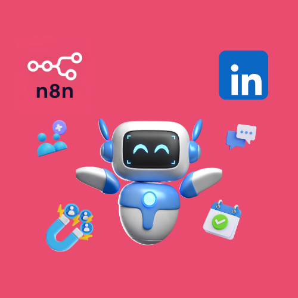
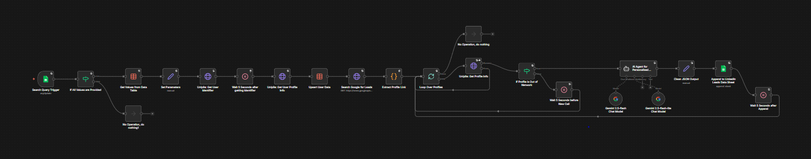
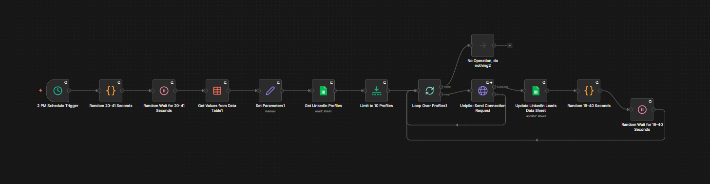
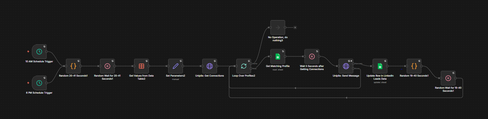
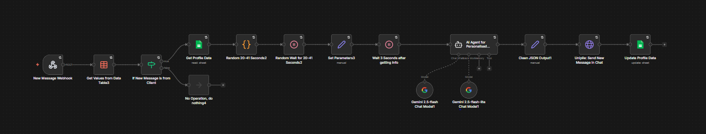

# AI-Powered LinkedIn Lead Generation and Engagement Suite

Four n8n workflows that find LinkedIn leads, send connection requests, message new connections, and answer incoming chats. Google Sheets stores the lead data, Unipile performs the LinkedIn actions, and Google Gemini writes the messages.

## Overview

The suite covers outreach in four stages. The **LinkedIn Lead Generator** uses the Google Custom Search API to find LinkedIn profiles that match a designation, industry, and city. It reads each profile through Unipile and logs it to a Google Sheets leads spreadsheet. The **LinkedIn Connection Invite Sender** sends connection requests to leads outside the user's network. The **LinkedIn First Personalised Message Sender** messages leads who accepted a request. The **LinkedIn Conversational AI Agent** receives replies through an n8n webhook and answers them with a Google Gemini agent.

All four workflows read shared settings from an n8n Data Table and use Wait nodes with random delays between actions. Each workflow references an error workflow in its settings.

LinkedIn Lead Generator:

LinkedIn Connection Invite Sender:

LinkedIn First Personalised Message Sender:

LinkedIn Conversational AI Agent:

## Workflows

| Workflow | Trigger | Purpose |
| --- | --- | --- |
| LinkedIn Lead Generator | Google Sheets Trigger, polling every minute | Finds LinkedIn profiles, drafts messages with Gemini, and logs leads to Google Sheets. |
| LinkedIn Connection Invite Sender | Schedule Trigger at 14:00 | Sends connection requests to out-of-network leads through Unipile. |
| LinkedIn First Personalised Message Sender | Schedule Triggers at 10:00 and 18:00 | Sends the first message to leads who accepted a connection request. |
| LinkedIn Conversational AI Agent | Webhook (POST) | Replies to client messages with a Gemini agent and records the conversation. |

## Workflow Details

### LinkedIn Lead Generator

This workflow turns a search query row into profile records and AI-drafted outreach messages.

Trigger: a Google Sheets Trigger polls the search query spreadsheet every minute.

1. An If node checks that Designation, Industry, and City are all filled. Otherwise the run ends in a No Operation node.
2. An n8n Data Table node reads the stored settings.
3. A Set node combines the search fields with the settings and restricts results to LinkedIn profile pages.
4. An HTTP Request node calls Unipile to retrieve the connected LinkedIn account, and a Wait node pauses 5 seconds.
5. A second Unipile request fetches the sender's own profile, and a Data Table node upserts the sender's provider ID, profile summary, and full name.
6. An HTTP Request node queries the Google Custom Search API with the designation, industry, and city.
7. A Code node extracts the profile link from each search result.
8. A Split In Batches node loops over the links. When the loop finishes, the run ends in a No Operation node.
9. For each link, an HTTP Request node calls Unipile to fetch the profile details. The error output returns to the loop.
10. An If node checks whether the profile is out of the sender's network.
11. Out-of-network profiles go to an AI Agent node that uses Gemini 2.5 Flash, with Gemini 2.5 Flash-Lite as the fallback model. The agent compares the sender's profile with the lead's profile and returns JSON with a connection message, a first message, and two follow-up messages.
12. A Set node strips code fences from the agent output so n8n can parse the JSON.
13. A Google Sheets node appends a row with the lead's details, the first message, and tracking columns set to invite not sent and message not sent.
14. A Wait node pauses 5 seconds and the loop continues.

Branching: profiles inside the sender's network skip the agent, wait 5 seconds, and return to the loop.

Integrations: Google Sheets, Unipile, Google Custom Search API, Google Gemini, n8n Data Tables.

### LinkedIn Connection Invite Sender

This workflow sends connection requests to up to 10 stored leads per run.

Trigger: a Schedule Trigger runs at 14:00.

1. A Code node generates a random delay between 20 and 41 seconds, and a Wait node applies it.
2. An n8n Data Table node reads the stored settings, and a Set node passes the Unipile settings to later nodes.
3. A Google Sheets node reads leads where Network Distance is OUT_OF_NETWORK and Invite Sent is No.
4. A Limit node keeps the first 10 leads.
5. A Split In Batches node loops over the leads. When the loop finishes, the run ends in a No Operation node.
6. An HTTP Request node sends a connection request through Unipile using the lead's provider ID.
7. On success, a Google Sheets node updates the lead's row by profile URL, setting Invite Sent to Yes and Invite Status to Pending.
8. A Code node generates a random delay between 19 and 40 seconds, a Wait node applies it, and the loop continues.

Branching: if the Unipile request returns an error, the workflow skips the sheet update and returns to the loop.

Integrations: Google Sheets, Unipile, n8n Data Tables.

### LinkedIn First Personalised Message Sender

This workflow sends the stored first message to leads who accepted a connection request.

Trigger: two Schedule Triggers run at 10:00 and 18:00 and feed the same sequence.

1. A Code node generates a random delay between 20 and 41 seconds, and a Wait node applies it.
2. An n8n Data Table node reads the stored settings, and a Set node passes the sender's name, provider ID, and Unipile settings to later nodes.
3. An HTTP Request node retrieves up to 25 connections from Unipile.
4. A Split In Batches node loops over the results. When the loop finishes, the run ends in a No Operation node.
5. A Google Sheets node finds the lead whose Provider ID matches the connection and whose invite is marked Yes with a Pending status.
6. A Wait node pauses 5 seconds.
7. An HTTP Request node starts a chat through Unipile and sends the lead's stored personalised message.
8. On success, a Google Sheets node updates the row by profile URL. It sets Message Sent to Yes, saves the Chat ID, starts the Chat History with the sent message, sets Network Distance to FIRST_DEGREE, and sets Invite Status to Accepted.
9. A Code node generates a random delay between 19 and 40 seconds, a Wait node applies it, and the loop continues.

Branching: if the Unipile request returns an error, the workflow skips the sheet update and returns to the loop.

Integrations: Google Sheets, Unipile, n8n Data Tables.

### LinkedIn Conversational AI Agent

This workflow answers client messages and guides the conversation toward a meeting.

Trigger: an n8n Webhook node receives a POST request for each new chat message.

1. An n8n Data Table node reads the stored settings, including the sender's provider ID and the Calendly meeting link.
2. An If node compares the message sender with the sender's own provider ID to confirm the message comes from a client.
3. A Google Sheets node finds the lead by Chat ID where Calendly Link Sent is No.
4. A Code node generates a random delay between 20 and 41 seconds, and a Wait node applies it.
5. A Set node collects the chat ID, the new message, the sender's details, and the Unipile settings, and a Wait node pauses 3 seconds.
6. An AI Agent node uses Gemini 2.5 Flash, with Gemini 2.5 Flash-Lite as the fallback model. It receives the sender's information, the lead's profile, the chat history, the new message, and the Calendly link.
7. The agent moves the conversation through four stages: initial contact, development, qualification with an email request, and meeting booking with the Calendly link. It returns JSON with a reply message, a Calendly link flag, and the client's email.
8. A Set node strips code fences from the agent output so n8n can parse the JSON.
9. An HTTP Request node posts the reply into the chat through Unipile.
10. A Google Sheets node updates the row by Chat ID. It appends the exchange to Chat History and saves the Calendly Link Sent value and the client email.

Branching: messages sent by the account owner end in a No Operation node.

Integrations: Google Sheets, Unipile, Google Gemini, Calendly, n8n Data Tables.

## Integrations

- Unipile: LinkedIn account, profile, connection, and chat access.
- Google Custom Search API: discovery of LinkedIn profile links.
- Google Sheets: search query input and leads tracking.
- Google Gemini: Gemini 2.5 Flash and Gemini 2.5 Flash-Lite for message drafting and replies.
- n8n Data Tables: shared settings and sender profile data.
- Calendly: meeting link shared in chat replies.

## Prerequisites

- An n8n instance that supports Data Tables and AI Agent nodes.
- A Unipile account with a connected LinkedIn account.
- A Google Programmable Search Engine with an API key and a search engine ID.
- A Google Gemini API credential, created in n8n as a Google Gemini (PaLM) API credential.
- A Google Sheets OAuth2 credential and a Google Sheets Trigger OAuth2 credential.
- A Calendly meeting link.
- A search query spreadsheet with the columns Designation, Industry, and City.
- A leads spreadsheet with the columns Designation, Industry, City, First Name, Last Name, Profile URL, Profile Info, Provider ID, Network Distance, Invite Sent, Personalized Message, Message Sent, Chat ID, Chat History, Invite Status, Email, and Calendly Link Sent.
- An n8n Data Table with the fields googleApiKey, searchEngineCx, unipileEndPoint, unipileApiKey, unipileLinkedInAccountId, userProviderId, userInfo, userFullName, and calendlyMeetingLink.

## Setup

1. Import each JSON file from the `workflows` directory into n8n.
2. Create the Google Sheets, Google Sheets Trigger, and Google Gemini credentials in n8n.
3. Create the Data Table and add a row with your Google search settings, Unipile settings, and Calendly meeting link. The Lead Generator upserts the sender profile fields.
4. Create the search query spreadsheet and the leads spreadsheet.
5. Select the Data Table in every Data Table node and select the spreadsheets in every Google Sheets node and in the trigger.
6. Assign the credentials to the Google Sheets, Google Sheets Trigger, and Google Gemini nodes.
7. Review the system messages of both AI Agent nodes and adjust them to your business.
8. Assign an error workflow in the settings of each workflow, or clear the setting.
9. Activate the four workflows, and send new-message notifications to the production webhook URL of the LinkedIn Conversational AI Agent.
10. Add a row with a designation, industry, and city to the search query spreadsheet to start the Lead Generator.
